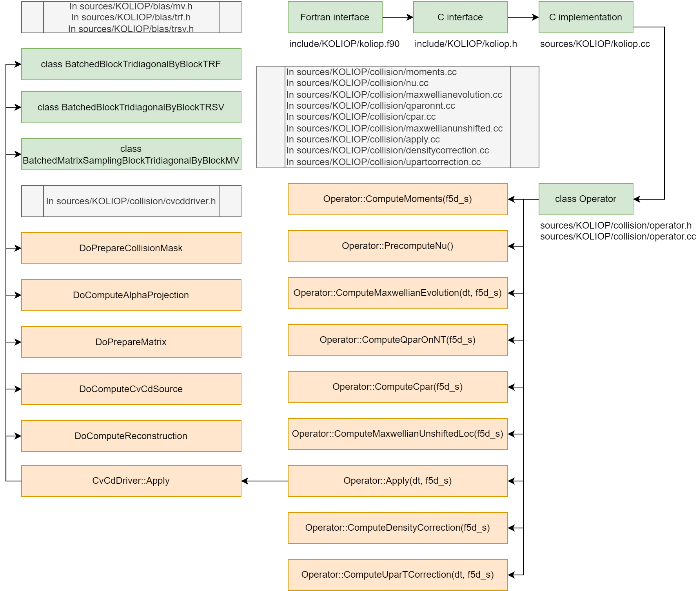

# Koliop

A KOkkos based colLIsion OPerator (KoLiOp) for Gysela that computes the evolution of the distribution function due to collisions. Some documents can be found in `/documents`.



## Building

### Cloning the repository

```bash
$ git clone https://gitlab.com/cines/code.gysela/libkoliop
```

### Dependencies

```
cmake > 3.16 (3.25 and up is recommended)
```

### Compiling

If you use [ninja](https://ninja-build.org/), then, under different platforms only the shell changes, not the command. We recommend the use of Ninja but if not possible, make should do as well.

```bash
$ mkdir build && cd build
# Using Ninja:
$ cmake .. -GNinja --toolchain=../toolchains/<machine_file>/toolchain.cmake
$ ninja
# Using make:
$ cmake .. --toolchain=../toolchains/<machine_file>/toolchain.cmake
$ make
```

Where `<machine_file>` being one of the supported machines. For instance:

```bash
$ cmake .. -GNinja --toolchain=../toolchains/mi250.cce.adastra/toolchain.cmake
```

Note that koliop expects that on GPU, the CMake variable `koliop_ASSUME_INPUT_BUFFERS_ARE_DEVICE_COMPATIBLE` be either `ON` or `OFF` but on CPU, expects it to be `ON`.

### Testing

Simply run the following command in the build directory (typically `build`).
```
$ ctest
Test project /lus/home/BCINES/dci/malaboeuf/repos/gysela-gpu-porting/koliop/build
    Start 1: test_dummy_test
1/1 Test #1: test_dummy_test ..................   Passed    0.61 sec

100% tests passed, 0 tests failed out of 1

Total Test time (real) =   0.63 sec
```

Note that to run the tests on Unix systems, one may need to run the following
command :
```
$ ulimit -s unlimited
```

This is due to our usage of of stack allocated (constant) buffer representing
the input to the operator. This stack issue could be avoided with the use of
dynamic allocation. The operator itself is not limited by the stack like the
test case is, thus, there is not need to `ulimit` to be called.

## Ideology

Generally, Keeping the interface (It) Simple (and Stupid) (KISS) is a good advice, though never remove necessary complexity (do not make it simpler, stupider that it should). An other view would be to try to use the weakest (less powerful) tool that satisfies the need (it requires that you know what you need, potentially months or years in advance).

## Coding style

<!--
TODO(): [LOOP|LOAD|SIMPLIFY|INDEX|ASYNC|COPY]
NOTE:
-->

## TODOs

- Some tuning:
    - Reduce register usage. Each time you use a view, you consume a LOT of register (dimension/stride storage ?).. much more than a simple pointer;
        - File a bug regarding this issue ?
        - One could construct the view inside the kernel, this would help the compiler factorize the register values.
    - Reduced precision ?:
        - NOTE: that the fact that we do not have pivoting for the LU factorization *could* reduce the precision more when treating Flo32 matrices.
    - operator fusing.
